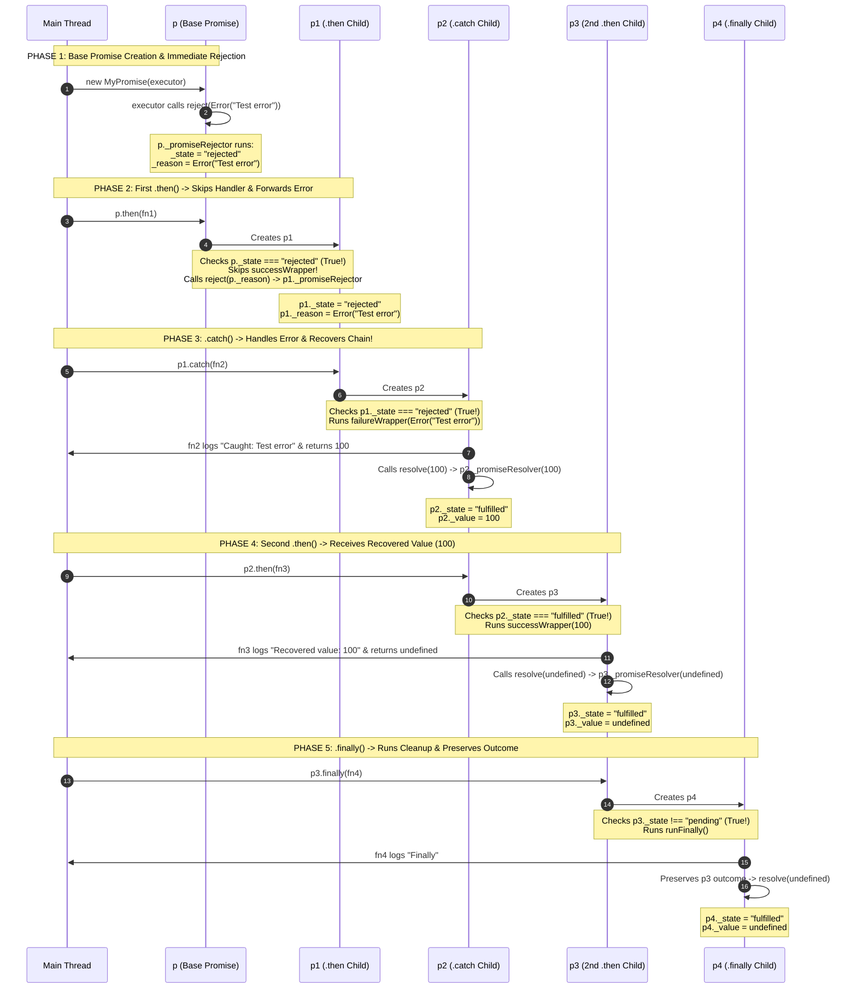

# MyPromise: Architecture, Execution Workflow & Lifecycle

Is document mein main `MyPromise` implementation aur neeche diye gaye test example ka execution step by step trace kar raha hoon. Isme IIFE se `PromiseState` object banana, `p` se `p4` tak promises kaise bante hain, rejected promise par `.then()` handler kyun skip hota hai, `.catch()` se `return 100` karne par chain kaise recover karti hai, aur `_promiseResolver` mein Promise adoption (`value instanceof MyPromise`) kaise kaam karta hai, yeh sab cover hai.

---

## 1. Code Overview

Yeh `MyPromise` implementation Promise ke kuch core behaviors dikhata hai. Pehle iske main parts dekhte hain:

### 1.1 IIFE `PromiseState` Pattern (Line 2-8)

```javascript
let PromiseState;
(function (PromiseState) {
  PromiseState["PENDING"] = "pending";
  PromiseState["FULFILLED"] = "fulfilled";
  PromiseState["REJECTED"] = "rejected";
})(PromiseState || (PromiseState = {}));
```

- **Yeh kya hai?** TypeScript ke `enum PromiseState` ko JavaScript mein compile (transpile) karne par compiler is tarah ka **IIFE (Immediately Invoked Function Expression)** generate karta hai.
- **Kaise kaam karta hai?** `(PromiseState || (PromiseState = {}))` zaroorat padne par ek khali object `{}` banata hai aur function ko deta hai. Function us object mein teen properties set karta hai: `{ PENDING: "pending", FULFILLED: "fulfilled", REJECTED: "rejected" }`.

### 1.2 Centralized Promise Adoption in `_promiseResolver` (Line 111-130)

Is implementation mein `.then()` aur `.catch()` ke andar `result instanceof MyPromise` check karne ke bajaye seedha `resolve(result)` call hota hai. **`_promiseResolver(value)` check karta hai** ki aayi hui value normal value hai ya `MyPromise` instance.

### 1.3 Consumer example (Line 159-179)

```javascript
const p = new MyPromise((resolve, reject) => {
  reject(new Error("Test error"));
});

p.then((value) => {
  console.log("This should not run:", value);
  return value * 2;
})
  .catch((error) => {
    console.log("Caught:", error.message);
    return 100;
  })
  .then((value) => {
    console.log("Recovered value:", value);
  })
  .finally(() => {
    console.log("Finally");
  });
```

---

## 2. Step-by-Step Workflow

Is example mein `reject(new Error("Test error"))` bina `setTimeout` ke **synchronously** call hota hai. Uske baad chaar methods chain hote hain (`.then` $\rightarrow$ `.catch` $\rightarrow$ `.then` $\rightarrow$ `.finally`).

Har method call ek **naya Promise** return karta hai. Is chain mein kul paanch promises bante hain:

- **`p`**: Base Promise (`new MyPromise(...)`)
- **`p1`**: Pehle `.then()` dwara return kiya gaya Child Promise
- **`p2`**: `.catch()` dwara return kiya gaya Child Promise
- **`p3`**: Doosre `.then()` dwara return kiya gaya Child Promise
- **`p4`**: `.finally()` dwara return kiya gaya Child Promise

Is execution ko paanch phases mein trace karte hain:

---

### Phase 1: Base promise `p` banana aur reject hona (Line 159-161)

Jab JavaScript engine is line ko execute karta hai:

```javascript
const p = new MyPromise((resolve, reject) => {
  reject(new Error("Test error"));
});
```

```text
+-------------------------------------------------------------------------+
| STEP 1: Memory Allocation & Field Initializations (Line 10-16)          |
| - Heap memory mein naya instance `p` banta hai:                          |
|   • _state = "pending"                                                  |
|   • _successCallbackHandlers = []                                       |
|   • _failureCallbackHandlers = []                                       |
|   • _finallyCallbackHandlers = []                                       |
|   • _value = undefined                                                  |
|   • _reason = undefined                                                 |
+-------------------------------------------------------------------------+
                                   │
                                   ▼
+-------------------------------------------------------------------------+
| STEP 2: Constructor Execution (Line 17-27)                              |
| - `try` block ke andar `executor` turant (synchronously) call hota hai: |
|     executor(                                                           |
|       this._promiseResolver.bind(this), // -> `resolve` parameter       |
|       this._promiseRejector.bind(this)  // -> `reject` parameter        |
|     );                                                                  |
+-------------------------------------------------------------------------+
                                   │
                                   ▼
+-------------------------------------------------------------------------+
| STEP 3: Executor Runs `reject(new Error("Test error"))` (Line 160)      |
| - `reject(...)` call hote hi `p._promiseRejector(Error)` method         |
|   (Line 141) execute hota hai.                                          |
+-------------------------------------------------------------------------+
                                   │
                                   ▼
+-------------------------------------------------------------------------+
| STEP 4: Inside `p._promiseRejector(reason)` (Line 141-156)              |
| 1. Guard Check (Line 143): `this._state !== "pending"` -> False         |
|    (kyunki state abhi "pending" hai, toh aage badho).                   |
| 2. State Update (Line 145): `p._state = "rejected"`                     |
| 3. Reason Store (Line 146): `p._reason = Error("Test error")`           |
| 4. Run Failure Callbacks (Line 148): `p._failureCallbackHandlers`       |
|    abhi khali `[]` hai (kyunki `.catch` abhi tak call nahi hua!).       |
| 5. Run Finally Callbacks (Line 152): `p._finallyCallbackHandlers`       |
|    bhi abhi khali `[]` hai.                                             |
| 6. Memory Cleanup (Line 153-155): Teeno arrays `[]` reset ho jate hain. |
+-------------------------------------------------------------------------+
```

#### Phase 1 ke baad `p` ki state:

```javascript
p = {
  _state: "rejected",
  _value: undefined,
  _reason: Error("Test error"),
  _successCallbackHandlers: [],
  _failureCallbackHandlers: [],
  _finallyCallbackHandlers: [],
};
```

---

### Phase 2: Pehla `.then()` call aur rejection forward karna (Line 162-165)

Ab pehla `.then()` us `p` par call hota hai jo pehle se `"rejected"` hai:

```javascript
// Trace ko aasan rakhne ke liye returned promise ko `p1` naam diya hai:
const p1 = p.then((value) => {
  console.log("This should not run:", value);
  return value * 2;
});
```

#### Step-by-Step Execution Inside `p.then(handlerFn)` (Line 28-61):

1. **Naya child promise (`p1`):**
   - Line 31: `return new MyPromise((resolve, reject) => { ... })`
   - Yahan naya promise **`p1`** banta hai.
   - Is `.then()` ke andar:
     - `this` = **`p`** (Parent Promise) hai!
     - `resolve` = **`p1._promiseResolver`** (Child Promise ka resolver) hai!
     - `reject` = **`p1._promiseRejector`** (Child Promise ka rejector) hai!

2. **`successWrapper` Function Definition (Line 32-48):**
   - `successWrapper` define hota hai. Iske andar `.then()` ko diya gaya `handlerFn` (`console.log("This should not run...")`) call hota hai.

3. **Parent (`p`) State Check (Line 49-59):**

   ```javascript
   if (this._state === PromiseState.FULFILLED) {
     successWrapper(this._value);
   } else if (this._state === PromiseState.REJECTED) {
     // Skip the success handler and forward the rejection.
     reject(this._reason);
   }
   ```

   - Kya `p._state === "fulfilled"` hai? **Nahi!**
   - Kya `p._state === "rejected"` hai? **Haan! (`true`)**
   - Isliye `successWrapper` skip hota hai aur `"This should not run"` print nahi hota.
   - Iske bajaye Line 54 par **`reject(this._reason)`** chalta hai.

4. **`reject(this._reason)` kya karta hai?**
   - Ye `p1._promiseRejector(p._reason)` ko call karta hai!
   - Isse Child Promise **`p1`** bhi turant `"rejected"` state mein chala jata hai aur uske `p1._reason` mein bhi wahi `Error("Test error")` copy ho jata hai!

#### Phase 2 ke baad `p1` ki state:

```javascript
p1 = {
  _state: "rejected",
  _value: undefined,
  _reason: Error("Test error"), // <-- `p` ka error `p1` mein forward ho gaya!
  _successCallbackHandlers: [],
  _failureCallbackHandlers: [],
  _finallyCallbackHandlers: [],
};
```

---

### Phase 3: `.catch()` call aur error recovery (Line 166-170)

Ab `.catch()` us `p1` par call hota hai jo `"rejected"` hai:

```javascript
// Trace ko aasan rakhne ke liye .catch() ke returned promise ko `p2` naam diya hai:
const p2 = p1.catch((error) => {
  console.log("Caught:", error.message);
  return 100;
});
```

#### Step-by-Step Execution Inside `p1.catch(handlerFn)` (Line 62-89):

1. **Naya child promise (`p2`):**
   - Line 64: `return new MyPromise((resolve, reject) => { ... })`
   - Yahan naya promise **`p2`** banta hai.
   - Yahan `this` = **`p1`** hai, `resolve` = **`p2._promiseResolver`** hai, aur `reject` = **`p2._promiseRejector`** hai.

2. **Parent (`p1`) State Check (Line 78-87):**

   ```javascript
   if (this._state === PromiseState.REJECTED) {
     // Handle a promise that has already been rejected.
     failureWrapper(this._reason);
   }
   ```

   - `p1._state` `"rejected"` hai, isliye `if` block turant chalta hai aur `failureWrapper(Error("Test error"))` call hota hai.

3. **`failureWrapper(reason)` ke andar (Line 65-77):**

   ```javascript
   const failureWrapper = (reason) => {
     try {
       const result = handlerFn(reason);
       resolve(result);
     } catch (error) {
       reject(error);
     }
   };
   ```

   - **Step A:** `handlerFn(reason)` chalta hai.
     - Console mein print hota hai: **`Caught: Test error`** _(Console Output #1)_.
     - Function return karta hai `100`, toh `const result = 100` ban jata hai.
   - **Step B:** Agli line chalti hai: **`resolve(100)`**!
   - **`.catch()` ke andar `resolve(100)` kyun chalta hai, `reject` kyun nahi?**
     - `.catch()` callback error ko handle karke normal value return kar sakta hai. Yahan callback `100` return karta hai, isliye agla promise fulfilled hota hai aur chain aage `.then()` mein chalti hai.
   - **Step C:** `resolve(100)` dar-asal **`p2._promiseResolver(100)`** ko call karta hai:
     - `p2._state` **`"fulfilled"`** ho jati hai.
     - `p2._value` mein **`100`** save hota hai.

#### Phase 3 ke baad `p2` ki state:

```javascript
p2 = {
  _state: "fulfilled", // Chain rejection se recover hokar fulfilled ho gayi.
  _value: 100, // Callback ki returned value yahan save hoti hai.
  _reason: undefined,
  _successCallbackHandlers: [],
  _failureCallbackHandlers: [],
  _finallyCallbackHandlers: [],
};
```

---

### Phase 4: Doosra `.then()` call — recovered value lena (Line 171-174)

Ab agla `.then()` us `p2` par call hota hai jo `"fulfilled"` hai aur jiski `_value` `100` hai:

```javascript
// Trace ko aasan rakhne ke liye is .then() ke returned promise ko `p3` naam diya hai:
const p3 = p2.then((value) => {
  console.log("Recovered value:", value);
});
```

#### Step-by-Step Execution Inside `p2.then(handlerFn)` (Line 28-61):

1. **Naya child promise (`p3`):**
   - Naya promise **`p3`** banta hai (`this` = `p2`, `resolve` = `p3._promiseResolver`).
2. **Parent (`p2`) State Check (Line 49):**
   - `if (this._state === PromiseState.FULFILLED)` $\rightarrow$ **true**, kyunki `p2` Phase 3 mein fulfill ho chuka hai.
   - `successWrapper(this._value)`, yani `successWrapper(100)`, call hota hai.
3. **Inside `successWrapper(100)`:**
   - `const result = handlerFn(100)` chalta hai.
   - Console mein **`Recovered value: 100`** print hota hai _(Console Output #2)_.
   - Kyunki is callback mein koi `return` statement nahi hai, `result` ki value `undefined` aati hai.
   - `resolve(undefined)` chalta hai $\rightarrow$ `p3._promiseResolver(undefined)`.
   - Isse `p3._state` `"fulfilled"` aur `p3._value` `undefined` ho jata hai.

#### Phase 4 ke baad `p3` ki state:

```javascript
p3 = {
  _state: "fulfilled",
  _value: undefined,
  _reason: undefined,
  _successCallbackHandlers: [],
  _failureCallbackHandlers: [],
  _finallyCallbackHandlers: [],
};
```

---

### Phase 5: `.finally()` call — outcome preserve karna (Line 175-178)

Ab `p3` par `.finally()` call hota hai:

```javascript
const p4 = p3.finally(() => {
  console.log("Finally");
});
```

#### Step-by-Step Execution Inside `p3.finally(handlerFn)` (Line 90-118):

1. **Naya child promise (`p4`):**
   - `return new MyPromise((resolve, reject) => { ... })` se naya promise **`p4`** banta hai (`this` = `p3`, `resolve` = `p4._promiseResolver`, `reject` = `p4._promiseRejector`).
2. **Parent (`p3`) State Check (Line 110-116):**

   ```javascript
   if (this._state === PromiseState.PENDING) {
     this._finallyCallbackHandlers.push(runFinally);
   } else {
     runFinally();
   }
   ```

   - Kya `p3._state === "pending"` hai? **Nahi!** (`p3` pehle se `"fulfilled"` hai).
   - Isliye `else` block chalta hai aur `runFinally()` turant call hota hai.

3. **Inside `runFinally()` (Line 93-109):**

   ```javascript
   const runFinally = () => {
     try {
       handlerFn();
       if (this._state === PromiseState.FULFILLED) {
         resolve(this._value);
       } else {
         reject(this._reason);
       }
     } catch (error) {
       reject(error);
     }
   };
   ```

   - **Step A:** `handlerFn()` chalta hai $\rightarrow$ Console mein **`Finally`** print hota hai _(Console Output #3)_.
   - **Step B:** `if (this._state === PromiseState.FULFILLED)` check true hota hai, kyunki `p3` fulfilled hai.
   - **Step C:** `resolve(this._value)`, yani `p4._promiseResolver(undefined)`, call hota hai. Isse `p4` bhi `"fulfilled"` ho jata hai.

---

## 3. Implementation ke 5 mechanisms

Is section mein resolver, callback aur cleanup ka flow detail mein dekha ja sakta hai:

---

### Mechanism 1: `_promiseResolver` mein Promise adoption (Line 127-136)

Is implementation mein `.then()` aur `.catch()` dono `resolve(result)` call karte hain. `result instanceof MyPromise` ka check `_promiseResolver(value)` ke andar hota hai:

```javascript
_promiseResolver(value) {
  if (this._state !== PromiseState.PENDING) return;

  if (value === this) {
    this._promiseRejector(new TypeError("A promise cannot resolve to itself."));
    return;
  }

  // Adopt another MyPromise instead of fulfilling with the promise object.
  if (value instanceof MyPromise) {
    value
      .then((resolvedValue) => {
        this._promiseResolver(resolvedValue);
      })
      .catch((reason) => {
        this._promiseRejector(reason);
      });
    return;
  }

  this._state = PromiseState.FULFILLED;
  this._value = value;
  ...
```

#### Flow

Maan lijiye `.then()` ke andar se `innerPromise` return hota hai, jo 2 second baad `500` resolve karega:

```javascript
p.then(() => {
  return new MyPromise((res) => setTimeout(() => res(500), 2000)); // innerPromise
});
```

1. `.then()` ka `successWrapper` chalta hai: `const result = handlerFn(value)` (jahan `result` = `innerPromise` hai).
2. Agli line chalti hai: `resolve(result)` $\rightarrow$ Jo Child Promise (`p1`) ka `p1._promiseResolver(innerPromise)` call karti hai.
3. Ab `p1._promiseResolver` ke andar `if (value instanceof MyPromise)` **TRUE** ho jata hai!
4. `innerPromise` abhi pending hai, isliye `p1` ki state `"fulfilled"` **nahi** hoti. Resolver `return` karta hai aur `p1` pending hi rehta hai.
5. Return karne se pehle `innerPromise.then(...)` register hota hai. `innerPromise` jab `500` resolve karega, callback `this._promiseResolver(500)` call karega.
6. Do second baad `p1._promiseResolver(500)` chalta hai. Is baar `500 instanceof MyPromise` **false** hota hai, aur `p1` `500` value ke saath fulfilled ho jata hai.

> Agar `innerPromise` se ek aur Promise return ho, to recursive call (`this._promiseResolver(resolvedValue)`) usse bhi adopt karne ki koshish karta hai.

---

### Mechanism 2: Self-resolution check (Line 120-125)

```javascript
if (value === this) {
  this._promiseRejector(new TypeError("A promise cannot resolve to itself."));
  return;
}
```

- Yeh check us case ko handle karta hai jahan Promise ko usi instance se resolve karne ki koshish hoti hai:
  ```javascript
  const p1 = p.then(() => p1); // Returning the exact same child promise!
  ```
- Yeh check na ho to `p1` khud ke resolve hone ka intezar karta rahega (circular dependency). Is case mein code `TypeError` ke saath promise ko reject karta hai.

---

### Mechanism 3: `.finally()` mein value pass-through aur error override (Line 90-118)

`runFinally` function mein `.finally(callback)` ke yeh behaviors dikhaye gaye hain:

1. **No Arguments:** `handlerFn()` ko koi argument (`value` ya `reason`) pass nahi kiya jata, kyunki `finally` ko isse matlab nahi hota ki promise resolve hua ya reject.
2. **Value/Rejection Preservation (Transparency):**
   ```javascript
   if (this._state === PromiseState.FULFILLED) {
     resolve(this._value);
   } else {
     reject(this._reason);
   }
   ```
   `.finally()` ke baad `.then()` ya `.catch()` ho, to pichle promise ki `_value` ya `_reason` agle promise tak pass hoti hai.
   - _Example:_ `Promise.resolve(42).finally(() => {}).then((val) => console.log(val))` $\rightarrow$ Yahan `42` print hoga!
3. **Error Override:** Agar `finally()` ke `handlerFn()` ke andar koi naya error `throw` ho jaye, toh `catch (error) { reject(error); }` pichli value ko hata kar is naye error se child promise ko reject kar deta hai.

---

### Mechanism 4: Promise pending ho to callback arrays kaise kaam karte hain?

Upar wale example mein `reject()` synchronous hai. Agar `p` mein `setTimeout` hota:

```javascript
const p = new MyPromise((resolve, reject) => {
  setTimeout(() => reject(new Error("Async error")), 1000);
});
```

Tab `.then()`, `.catch()` aur `.finally()` call hote waqt:

1. `p._state` `"pending"` hoti.
2. `p.then()` apna `successWrapper` $\rightarrow$ `p._successCallbackHandlers` array mein push kar deta.
3. 1000ms baad `reject()` chalne par `_promiseRejector` ke andar:
   ```javascript
   this._failureCallbackHandlers.forEach((callback) => {
     callback(this._reason);
   });
   this._finallyCallbackHandlers.forEach((callback) => callback());
   ```
   Save hue wrappers ek-ek karke chalte hain.

---

### Mechanism 5: Callback cleanup aur garbage collection (Line 143-145 & 153-155)

`_promiseResolver` aur `_promiseRejector` dono ke aakhri mein ye 3 lines likhi hain:

```javascript
// Release callback references after execution.
this._successCallbackHandlers = [];
this._failureCallbackHandlers = [];
this._finallyCallbackHandlers = [];
```

- Promise settle hone ke baad callbacks chal chuke hote hain, isliye arrays ko `[]` karne se unke references hat jate hain. Agar un functions ya closures ka koi aur reference na ho, to JavaScript ka **Garbage Collector** baad mein unki memory reclaim kar sakta hai. Isse callbacks ko promise par be-wajah hold karke rakhne se bacha ja sakta hai.

---

## 4. Wrapper functions ka role

| Function / Method Name         | Kahan Define Hua?              | Array Jisme Save Hota Hai (If Pending) | Iska Exact Kaam Kya Hai?                                                                                                                     |
| :----------------------------- | :----------------------------- | :------------------------------------- | :------------------------------------------------------------------------------------------------------------------------------------------- |
| **`successWrapper(value)`**    | `then()` ke andar (Line 32)    | `_successCallbackHandlers`             | User ka `handlerFn(value)` chalana aur uske output (`result`) se Child Promise ko `resolve(result)` karna.                                   |
| **`failureWrapper(reason)`**   | `catch()` ke andar (Line 65)   | `_failureCallbackHandlers`             | Error handle karne ke liye `handlerFn(reason)` chalana aur return value se Child Promise ko **`resolve(result)`** karke chain recover karna. |
| **`runFinally()`**             | `finally()` ke andar (Line 93) | `_finallyCallbackHandlers`             | Cleanup `handlerFn()` chalana aur parent promise ki original `_value` ya `_reason` ko aage forward karna.                                    |
| **`_promiseResolver(value)`**  | Class Method (Line 119)        | Bound as `resolve` in Constructor      | Self-resolution check karna, `MyPromise` instances ko unwrap karna, `_state = "fulfilled"` karna aur callbacks trigger karna.                |
| **`_promiseRejector(reason)`** | Class Method (Line 141)        | Bound as `reject` in Constructor       | `_state = "rejected"` karna, `_reason` save karna aur failure/finally callbacks trigger karna.                                               |

---

## 5. Is example ka sequence diagram



---

## 6. Execution Summary Table

| Step  | Code Line      | Operation Executed                                                                                              | Promise Created / Targeted | Resulting `_state` | `_value`    | `_reason`             | Console Output         |
| :---- | :------------- | :-------------------------------------------------------------------------------------------------------------- | :------------------------- | :----------------- | :---------- | :-------------------- | :--------------------- |
| **1** | `Line 159-161` | `new MyPromise` calls `reject(new Error("Test error"))`                                                         | **`p`**                    | `"rejected"`       | `undefined` | `Error("Test error")` | —                      |
| **2** | `Line 162-165` | `p.then(...)` sees `p` is `"rejected"`, skips `successWrapper`, calls `reject(this._reason)`                    | **`p1`**                   | `"rejected"`       | `undefined` | `Error("Test error")` | _(Skipped)_            |
| **3** | `Line 166-170` | `.catch(...)` sees `p1` is `"rejected"`, runs `failureWrapper`, logs error, returns `100`, calls `resolve(100)` | **`p2`**                   | **`"fulfilled"`**  | **`100`**   | `undefined`           | `Caught: Test error`   |
| **4** | `Line 171-174` | `.then(...)` sees `p2` is `"fulfilled"`, runs `successWrapper(100)`, logs value, returns `undefined`            | **`p3`**                   | `"fulfilled"`      | `undefined` | `undefined`           | `Recovered value: 100` |
| **5** | `Line 175-178` | `.finally(...)` sees `p3` is settled, runs `runFinally()`, logs `"Finally"`, preserves `p3` state               | **`p4`**                   | `"fulfilled"`      | `undefined` | `undefined`           | `Finally`              |
