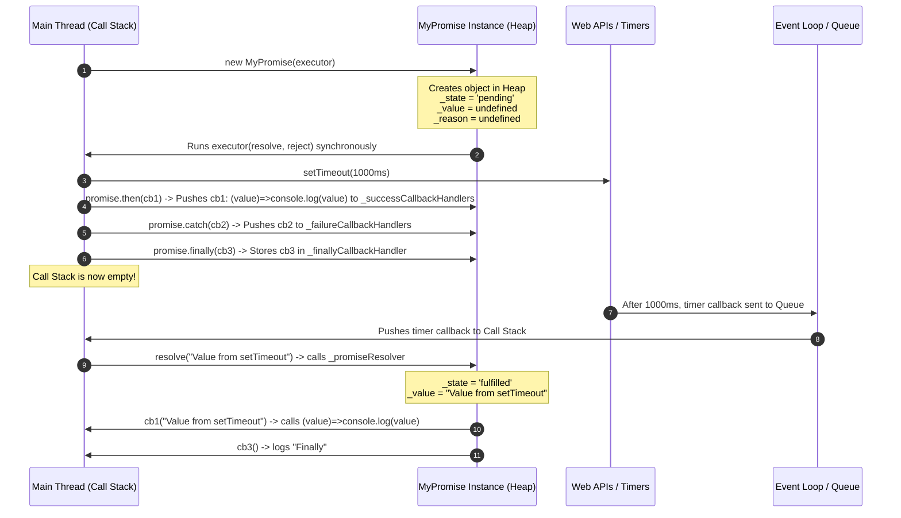

# MyPromise: Execution Workflow & Lifecycle

Is document mein main `temp.ts` ke `MyPromise` code ka execution step by step explain kar raha hoon: instance kaise banta hai, constructor kab chalta hai, `_value` aur `_reason` kis kaam aate hain, `.forEach((cb) => cb(value))` mein `cb` kaunsa function hota hai, aur callbacks ka flow kaise chalta hai.

---

## 1. Code Overview

```javascript
// Variables at Line 14-15
this._value = undefined;
this._reason = undefined;

// Line 66: Instance Creation
const p = new MyPromise((resolve, reject) => {
  setTimeout(() => {
    resolve("Data mil gaya!");
  }, 1000);
});

// Line 72: Chaining & Subscribing
p.then((data) => console.log(data))
  .catch((err) => console.error(err))
  .finally(() => console.log("Done!"));
```

---

## 2. Step-by-Step Workflow

Execution ko **3 main phases** mein baanta ja sakta hai:

1. **Phase 1 (Line 66)**: Object Instantiation & Constructor Execution (`new MyPromise(...)`)
2. **Phase 2 (Line 72-74)**: Handler Registration & Method Chaining (`.then()`, `.catch()`, `.finally()`)
3. **Phase 3 (After 1000ms)**: Asynchronous Resolution & Handler Execution

---

### Phase 1: Object Creation (`new MyPromise(...)`)

Jab JavaScript engine `const promise = new MyPromise(executor)` par aata hai:

```
+-------------------------------------------------------------------------+
| STEP 1: Memory Allocation                                               |
| - JS Engine Heap memory mein ek naya empty object `{}` create karta hai |
| - Iska prototype link hota hai `MyPromise.prototype` se.                |
+-------------------------------------------------------------------------+
                                   │
                                   ▼
+-------------------------------------------------------------------------+
| STEP 2: Field Initializations (Default Values)                          |
| Naye object pe properties initialize hoti hain:                         |
|   • _state = PromiseState.PENDING ("pending")                           |
|   • _successCallbackHandlers = []                                       |
|   • _failureCallbackHandlers = []                                       |
|   • _finallyCallbackHandler = undefined                                 |
|   • _value = undefined   <-- (Line 27)                                  |
|   • _reason = undefined  <-- (Line 28)                                  |
+-------------------------------------------------------------------------+
                                   │
                                   ▼
+-------------------------------------------------------------------------+
| STEP 3: Constructor Call (`constructor(executor)`)                      |
| - `this` context abhi bane naye instance object ko point karta hai.     |
| - Constructor ke andar:                                                 |
|     executor(                                                           |
|       this._promiseResolver.bind(this),                                 |
|       this._promiseRejector.bind(this)                                  |
|     );                                                                  |
| - `.bind(this)` ensure karta hai ki jab resolver/rejector call honge    |
|   tab `this` hamesha isi Promise instance ko refer kare.                |
+-------------------------------------------------------------------------+
                                   │
                                   ▼
+-------------------------------------------------------------------------+
| STEP 4: Executor Execution (SYNCHRONOUS)                                |
| - Executor function turant execute hota hai.                            |
| - Andar `setTimeout(..., 1000)` call hota hai.                          |
| - `setTimeout` browser/Node Web API (Timer) ko timer hand over          |
|   kar deta hai (1000ms ke liye).                                        |
| - Executor synchronous return ho jata hai (timer background mein hai).  |
+-------------------------------------------------------------------------+
                                   │
                                   ▼
+-------------------------------------------------------------------------+
| STEP 5: Variable Assignment                                             |
| - `new MyPromise(...)` instance ka reference return karta hai.          |
| - Wo reference `promise` variable mein store ho jata hai.               |
+-------------------------------------------------------------------------+
```

#### Is point par `promise` object ki internal state:

```javascript
promise = {
  _state: "pending",
  _value: undefined, // Abhi value resolve nahi hui
  _reason: undefined, // Koi error nahi hai
  _successCallbackHandlers: [],
  _failureCallbackHandlers: [],
  _finallyCallbackHandler: undefined,
};
```

---

### Phase 2: Method Calls & Handler Registration (Line 83 - 86)

JavaScript **single-threaded synchronous** execution karta hai. Isliye Line 77 complete hote hi, bina 1000ms ka wait kiye, engine turant Line 83 par aata hai:

```javascript
promise
  .then((value) => console.log(value))
  .catch((reason) => console.log(reason))
  .finally(() => console.log("Finally"));
```

#### Step-by-Step:

1. **`promise.then(handlerFn)` call hota hai:**
   - Parameter `handlerFn` = `(value) => console.log(value)`
   - `this._state` check hota hai: kya ye `FULFILLED` hai?
   - Nahi, `this._state` abhi `"pending"` hai!
   - Isliye `else` block chalta hai:
     ```javascript
     this._successCallbackHandlers.push(handlerFn);
     ```
   - Callback function `(value) => console.log(value)` array `_successCallbackHandlers` mein store ho jata hai.
   - `return this;` — wahi `promise` instance return hota hai, isliye agla method call usi instance par hota hai.

2. **`.catch(handlerFn)` call hota hai:**
   - Return hue same instance pe `.catch` chalta hai.
   - `this._state` abhi bhi `"pending"` hai (`REJECTED` nahi hai).
   - Isliye callback array `_failureCallbackHandlers` mein push ho jata hai.
   - `return this;` — wahi instance wapas return hota hai.

3. **`.finally(handlerFn)` call hota hai:**
   - `this._state !== PromiseState.PENDING` check hota hai (false, kyunki state `"pending"` hai).
   - `this._finallyCallbackHandler = handlerFn;`
   - Callback `() => console.log("Finally")` property mein store ho jata hai.

#### Phase 2 ke baad Memory State:

```javascript
promise = {
  _state: "pending",
  _value: undefined,
  _reason: undefined,
  _successCallbackHandlers: [
    (value) => console.log(value), // <-- Ye function yahan store ho chuka hai!
  ],
  _failureCallbackHandlers: [(reason) => console.log(reason)],
  _finallyCallbackHandler: () => console.log("Finally"),
};
```

Synchronous code complete hone ke baad Call Stack khali ho jata hai. Timer complete hone tak JavaScript Event Loop callback ka intezar karta hai.

---

### Phase 3: 1000ms ke baad Async Execution (Timer Complete)

1. **1000ms poore hone par:**
   - Timer expire hota hai aur uska callback Task Queue / Callback Queue mein chala jata hai.
   - Event loop us callback `() => { resolve("Value from setTimeout"); }` ko Call Stack pe push karta hai.

2. **`resolve("Value from setTimeout")` call hota hai:**
   - Ye dar-asal `_promiseResolver` method hai (jo constructor mein bind hua tha).

3. **`_promiseResolver(value)` ke andar:**

   ```javascript
   _promiseResolver(value) {
     if (this._state === PromiseState.FULFILLED) return; // (1) Guard check
     this._state = PromiseState.FULFILLED;               // (2) State badal kar 'fulfilled' hui
     this._value = value;                                // (3) Line 27: _value set hui "Value from setTimeout"
     this._successCallbackHandlers.forEach((cb) => cb(value)); // (4) Stored callbacks ko run kiya
     if (this._finallyCallbackHandler) this._finallyCallbackHandler(); // (5) Finally callback run kiya
   }
   ```

   - **(1) State Check**: Agar promise pehle hi resolve ho chuki hoti toh execution return ho jata (Promise state immutable hoti hai).
   - **(2) State Change**: `_state` change hokar `PromiseState.FULFILLED` ban jati hai.
   - **(3) Value Store (Line 27)**: `_value` mein `"Value from setTimeout"` assign ho jata hai.
   - **(4) Success Handlers Run**: `_successCallbackHandlers` array par loop chalta hai (iska detail explanation Section 3 mein hai).
   - **(5) Finally Handler Run**: `_finallyCallbackHandler` call hota hai $\rightarrow$ Console Output: `"Finally"`.

---

## 3. `.forEach((cb) => cb(value))` mein `cb` kaunsa function hai?

> [!IMPORTANT]
> `resolve`, `reject` aur `setTimeout` ka zikr dekhkar `cb` ko lekar sawaal aa sakta hai: `cb` kya hai aur kahan se aata hai?

### Seedha jawab

**`cb` wohi function hai jo `.then(...)` ko pass kiya gaya hai.**

Is example mein `.then()` ko yeh function pass hota hai:

```javascript
promise.then((value) => console.log(value));
```

Yahan `(value) => console.log(value)` ek **anonymous function** hai. `.then()` ise handler ke roop mein receive karke array mein store karta hai; baad mein resolver isi function ko `cb` naam se call karta hai.

---

### Function ka safar (Functions as First-Class Citizens)

JavaScript mein functions ko values ki tarah pass aur store kiya ja sakta hai. Is example mein function ka safar yeh hai:

```
Step A (`.then()` ko function pass hota hai):
.then( (value) => console.log(value) )
         │
         ▼
Step B (`then` method us function ko `handlerFn` parameter mein receive karta hai):
public then(handlerFn) {
  ...
  this._successCallbackHandlers.push(handlerFn); // Array mein save kar diya
}
         │
         ▼
Step C (Function promise ke array mein store hota hai):
_successCallbackHandlers = [
   (value) => console.log(value)
]
         │
         ▼
Step D (1000ms baad `resolve` chalte waqt):
this._successCallbackHandlers.forEach((cb) => cb(value));
                                       │       │
                                       │       └─> cb("Value from setTimeout")
                                       │
                                       └─> 'cb' represents Array ka element,
                                           jo ki wahi function hai:
                                           (value) => console.log(value)
```

---

### `.forEach()` ke andar kya hota hai?

Jab `.forEach()` chalta hai, to callback ko value ke saath call kiya jata hai:

```javascript
// cb(value) is basically executing:
((value) => console.log(value))("Value from setTimeout");

// Jisse console mein print hota hai:
// "Value from setTimeout"
```

---

### Kaunsa function kya karta hai?

| Function Name / Term               | Kisne Define Kiya?                       | Kab Chala?                                    | Iska Kaam Kya Hai?                                                        |
| :--------------------------------- | :--------------------------------------- | :-------------------------------------------- | :------------------------------------------------------------------------ |
| **`setTimeout`**                   | Browser / Node Web API                   | Constructor ke andar (Line 78)                | 1000ms ka delay/timer manage karna                                        |
| **`resolve` (`_promiseResolver`)** | `MyPromise` class                        | 1000ms baad timer complete hone par (Line 79) | Promise ki state `"fulfilled"` karna aur saved callbacks ko trigger karna |
| **`cb` (`handlerFn`)**             | `.then()` ko diya gaya consumer callback | `resolve` hone ke baad (Line 64)              | Result aane par custom logic run karna (`console.log(value)`)             |

---

### Array par `.forEach()` kyun chalta hai?

Kyunki ek hi Promise par multiple `.then()` handlers lagaye ja sakte hain:

```javascript
promise.then((val) => console.log("Handler 1:", val));
promise.then((val) => console.log("Handler 2:", val));
```

Aise case mein `_successCallbackHandlers` array mein **2 functions** honge:

```javascript
_successCallbackHandlers = [
  (val) => console.log("Handler 1:", val), // cb #1
  (val) => console.log("Handler 2:", val), // cb #2
];
```

Jab `forEach((cb) => cb(value))` chalega:

1. Pehle `cb #1` chalega $\rightarrow$ Output: `"Handler 1: Value from setTimeout"`
2. Fir `cb #2` chalega $\rightarrow$ Output: `"Handler 2: Value from setTimeout"`

Isliye `.forEach()` se register hue saare `.then()` callbacks ek-ek karke chalte hain.

---

## 4. Line 14 (`_value`) aur Line 15 (`_reason`) ka kaam

```javascript
this._value = undefined;
this._reason = undefined;
```

### Dono properties ka role

1. **Result Storage (Payload Holder)**:
   - Promise future mein milne wali value ko represent karta hai. Operation complete hone tak result `undefined` rehta hai.
   - Jab operation successfully complete hota hai, result `_value` mein store hota hai.
   - Jab operation fail hota hai, error/reason `_reason` mein store hota hai.

2. **State Immutability (Ek baar resolve/reject hone ke baad value lock ho jaana)**:
   - `_state` `FULFILLED` hone ke baad `_value` set rehti hai. Is implementation mein dobara `resolve()` call karne par yeh value change nahi hoti.

3. **Late Attachment (`.then()` called after resolution)**:
   - Promise resolve hone ke _baad_ `.then()` call ho to:
     ```javascript
     if (this._state === PromiseState.FULFILLED) {
       handlerFn(this._value); // <-- Yahan saved _value direct pass hoti hai!
     }
     ```
   - Kyunki `_value` already saved hai, `.then()` ko turant value mil jati hai bina array mein push kiye.

---

## 5. Execution Flow Diagram



---

## 6. Execution Summary

| Step  | Code Line      | Action                                                                               | Object State | `_value`                  |
| :---- | :------------- | :----------------------------------------------------------------------------------- | :----------- | :------------------------ |
| **1** | `Line 66`      | `new MyPromise(...)` called                                                          | `pending`    | `undefined`               |
| **2** | `Line 18-21`   | Constructor calls executor, `setTimeout` started                                     | `pending`    | `undefined`               |
| **3** | `Line 72`      | `.then(fn)` attaches success handler `fn: (val)=>console.log(val)` to array          | `pending`    | `undefined`               |
| **4** | `Line 73`      | `.catch(fn)` attaches failure handler to array                                       | `pending`    | `undefined`               |
| **5** | `Line 74`      | `.finally(fn)` attaches finally handler                                              | `pending`    | `undefined`               |
| **6** | `1000ms later` | Timer expires, `resolve()` called                                                    | `fulfilled`  | `"Value from setTimeout"` |
| **7** | `Line 53`      | `.forEach((cb) => cb(value))` runs saved `fn` with `_value` $\rightarrow$ Logs value | `fulfilled`  | `"Value from setTimeout"` |
| **8** | `Line 42`      | Invokes `_finallyCallbackHandler` $\rightarrow$ Logs "Finally"                       | `fulfilled`  | `"Value from setTimeout"` |
